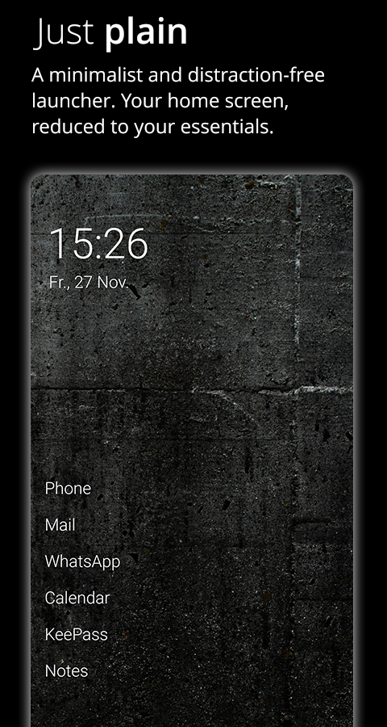
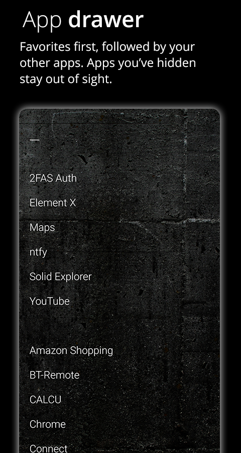
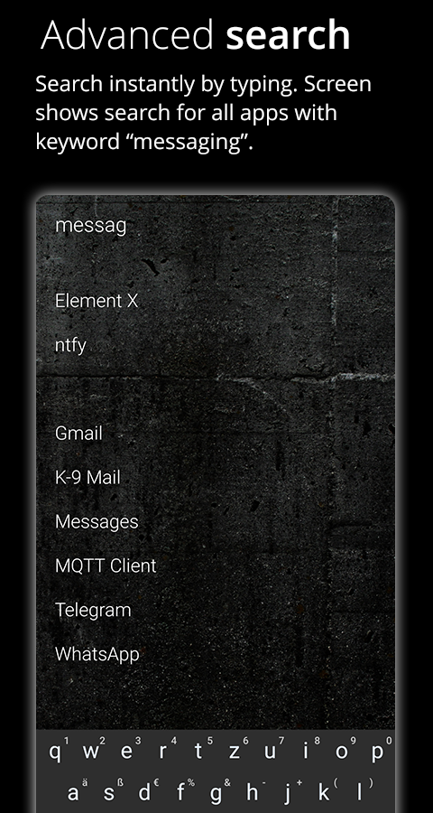

# plain

A simple and minimalist Android launcher, a fork of the archived [Olauncher CF](https://github.com/OlauncherCF/OlauncherCF). Requires Android 9+, developed for Android 13+. GPL-3.0.

  

## Features
- **Minimalist & Distraction-Free:** Clean, clutter-free design without ads, tracking, data collection, or internet access.
- **Privacy & Minimal Permissions:** Only uses essential permissions. An optional Accessibility Service is only required if you want to use gestures to lock the screen or open recents.
- **System Wallpaper:** Does not set its own background, seamlessly using your current system wallpaper instead.
- **Customizable Appearance:** Choose between a light or dark theme (manually or synced with system settings), pick custom fonts and colors, adjust font sizes, and independently align the clock/date, home screen apps, and app drawer.
- **Clock & Date:** Optional display with customizable tap actions.
- **Custom Gestures:** Assign individual actions to swipe-up, swipe-down, swipe-left, swipe-right, and double-tap gestures.
- **Flexible Home Screen App Sets:** Create any number of app sets with no fixed app limit, easily reorder apps, and customize home screen app names via the settings menu. While you can switch sets manually, they are primarily designed for automatic switching via automation apps (such as Tasker) using Android Intents—letting you use dedicated app setups for home, on the go, or in the car.
- **Smart App Drawer & Search:** Search apps via keyboard with an optional auto-launch when only one match remains. Long-press any app to rename it (independently from its home screen name), hide it, view app info, or uninstall it.
- **App Keywords:** Assign custom keywords to apps in the drawer (via long-press) to include them in keyboard searches. Group apps under a single tag (e.g., "Messaging" for mail, SMS, and chat apps), add intuitive terms for hard-to-remember app names (e.g., "TV" for a guide app), or set short aliases for rapid launching.
- **Favorites:** Mark apps as favorites (via long-press in the drawer) to keep them pinned at the top of your app list.
- **Progressive Web Apps (PWA) & Shortcuts:** Supports pinned shortcuts, such as websites added via Chrome's "Install" or "Create shortcut" option (requires **plain** to be set as the default launcher). These appear in the app drawer and can be used in app sets and gestures.
- **Under the Hood:** Completely refactored codebase with extensive bug fixes and optimizations.

## Permissions
**plain** uses the following permissions:

- `android.permission.EXPAND_STATUS_BAR`
  - Allows an application to expand or collapse the status bar.
- `android.permission.QUERY_ALL_PACKAGES`
  - Allows query of any normal app on the device, regardless of manifest declarations. Used to show the apps list.
- `android.permission.REQUEST_DELETE_PACKAGES`
  - Required for issuing the request to remove packages. This does not allow the app to remove apps directly; this only gives the permission to issue the request.
- **Optional Accessibility Service:** Used exclusively for locking the screen and showing recent apps.
- **No network access, no data collection.**
